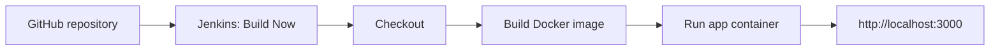

# Docker + Jenkins Automation Project

A small CI pipeline that checks out a GitHub repository, builds a Docker image for a Node.js HTTP app, and replaces a running container when the Jenkins job is triggered with **Build Now**.

> **Scope:** coursework / learning lab. This repository demonstrates a basic Jenkins pipeline; it is not a production deployment design.

## Pipeline



## Technologies

- Jenkins Declarative Pipeline
- Docker / Docker Desktop
- GitHub SCM
- WSL 2 with Ubuntu
- Node.js HTTP server

## Repository files

```text
05-docker-jenkins-automation/
├── app.js
├── Dockerfile
├── Jenkinsfile
├── .dockerignore
├── .gitignore
├── README.md
└── docs/
    └── project-report.pdf
```

## How it works

1. **Checkout:** Jenkins checks out the configured Git repository using `checkout scm`.
2. **Build Docker Image:** Jenkins builds `jenkins-demo-app:latest` from this folder's Dockerfile.
3. **Run Container:** The pipeline removes any existing `jenkins-demo-container` and starts a replacement on host port `3000`.

The app responds with:

```text
Hello from Jenkins + Docker automation!
```

## Run the application locally with Docker

From the repository root:

```bash
docker build -t jenkins-demo-app:local ./05-docker-jenkins-automation
docker run --rm -p 3000:3000 jenkins-demo-app:local
```

Open `http://localhost:3000` in a browser. Stop the foreground container with `Ctrl+C`.

## Configure Jenkins for this monorepo

Prerequisites:

- Docker Desktop is running and WSL integration is enabled for the Ubuntu distribution.
- Jenkins is already running and can reach the Docker engine through the lab's configured Docker CLI/socket arrangement.
- Jenkins can read the GitHub repository that contains this folder.

Create a Jenkins item of type **Pipeline** and configure **Pipeline script from SCM**:

- **SCM:** Git
- **Repository URL:** the HTTPS URL of this cloud-computing portfolio repository
- **Branch Specifier:** `*/main`
- **Script Path:** `05-docker-jenkins-automation/Jenkinsfile`

Save the job and click **Build Now**. The pipeline should show the `Checkout`, `Build Docker Image`, and `Run Container` stages. Then visit `http://localhost:3000` on the Docker host.

If checkout fails on a fresh workspace, review the full Jenkins console log first. The coursework setup required disabling **Lightweight checkout** and clearing a stale workspace after earlier failures; do not delete the workspace while a build is running.

## Security notes

- The original lab connected the Jenkins container to the host Docker daemon by mounting `/var/run/docker.sock` and supplied the Docker CLI. It also ran Jenkins as root to work around socket permissions. This gives jobs powerful control over the host's Docker engine and is **not an appropriate default for a shared or production Jenkins service**.
- Keep the lab local or isolated. Do not expose an unauthenticated Jenkins service to the public internet.
- Prefer an isolated, disposable build agent or a dedicated remote builder with tightly controlled access. Do not treat containerization alone as a security boundary when the host Docker socket is mounted.
- The course report used `node:18-alpine`. This portfolio copy uses `node:24-alpine` and a non-root user for the application container. Node.js 18 reached end of life on 30 April 2025, so it no longer receives upstream security fixes. Check the official release schedule before future runtime updates: <https://nodejs.org/en/about/previous-releases>.
- Do not commit credentials, `.env` files, `.pem` private keys, Jenkins secrets, or local state.

## What I learned

- Writing a Jenkins Declarative Pipeline with checkout, image build, and container-run stages.
- Connecting Docker Desktop to an Ubuntu WSL 2 environment.
- Understanding the difference between Jenkins running as a native service and Jenkins running inside a container.
- Diagnosing Docker CLI availability, Docker socket permissions, SCM checkout issues, and stale workspaces.
- Triggering a repeatable container build and run from a Jenkins job.

## Improvements to explore

- Trigger builds from a GitHub webhook instead of relying only on **Build Now**.
- Add automated tests and a post-deployment HTTP smoke test.
- Pin Jenkins and Docker image versions rather than using mutable `latest` tags.
- Use isolated build agents instead of mounting the host Docker socket into the Jenkins controller.
- Add health checks, structured logs, and image scanning.

## Report

See [`docs/project-report.pdf`](docs/project-report.pdf) for the cleaned portfolio report based on the coursework steps and observed build results.
